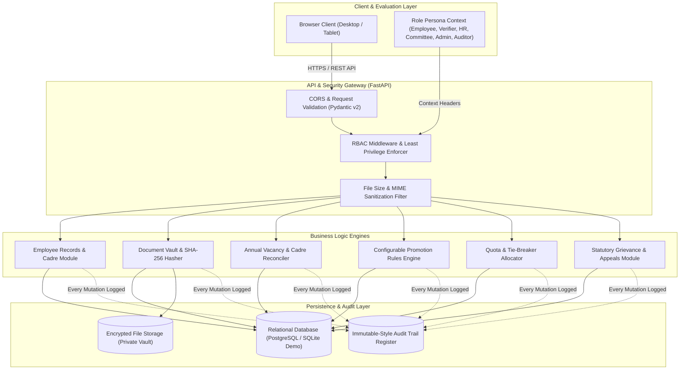

# FairGov AI — System Architecture & Data-Flow Specification

## 1. Architectural Principles
FairGov AI employs a modular, secure, API-first architecture designed to align with the Ministry of Electronics and Information Technology (MeitY) and National Informatics Centre (NIC) enterprise standards:
1. **Decoupled Presentation & Business Logic**: Fast, accessible React + TypeScript frontend communicating over authenticated, typed REST endpoints with a Python FastAPI backend.
2. **Statutory Rules Separation**: Promotion criteria, benchmark definitions, and quota formulas are separated from the code engine into version-controlled rule objects linked to official government Office Memorandums (e.g., DoPT OM No. 22011/1/2023-Estt(D)).
3. **Cryptographic Checksumming**: Every service book, credential, and dossier file receives a SHA-256 hash upon ingestion to prevent unauthorized substitution or tampering.
4. **Verifiable Receipts**: Promotion application submissions issue a deterministic receipt hash combining the applicant reference, vacancy identifier, and submission timestamp.
5. **Auditable Lifecycle Trajectory**: All state transitions record actor, role, IP address, and pre/post state differences.

---

## 2. High-Level Architecture Diagram

---

## 3. End-to-End Data Flow

### Flow 1: Document Upload & Integrity Check
1. Officer/Assistant uploads PDF/image (capped at 15MB).
2. FastAPI processes file bytes and executes `calculate_sha256_bytes(bytes)`.
3. System executes a collision query: `SELECT id FROM documents WHERE file_sha256 = :hash`.
4. If identical hash found, `is_duplicate_flag` is set to `True` and an automated audit risk anomaly is logged.
5. Document saved to private storage vault with status `SUBMITTED`.

### Flow 2: Promotion Eligibility & Explainable Evaluation
1. Establishment section triggers evaluation for a published vacancy notice.
2. System loads active `PromotionRuleSet` linked to the feeder designation.
3. For each candidate application:
   - **Tenure Check**: `(evaluation_cutoff_date - joining_date).days / 365.25 >= min_years_qualifying_service`.
   - **Benchmark Check**: `average(last_5_years_apar) >= apar_benchmark`.
   - **Vigilance Check**: `vigilance_status == "CLEAR"` (if `PENDING_INQUIRY`, flagged for Sealed Cover).
   - **Scoring**: `Seniority Score = min(100, (years / 15) * 100)`; `Merit Score = (apar_avg / 5.0) * 100`.
   - `Composite Score = (Seniority × seniority_weight%) + (Merit × merit_weight%)`.
4. Algorithm assigns provisional rank, applying statutory tie-breakers:
   - Priority 1: Seniority of feeder appointment date.
   - Priority 2: Date of birth (older candidate ranked higher).
5. Quotas allocated: UR merit filled first; reserved category quotas (SC, ST, OBC, EWS, PwBD) filled subsequently.
6. Complete math substitution string stored in `evaluation_result` for instant candidate transparency.
